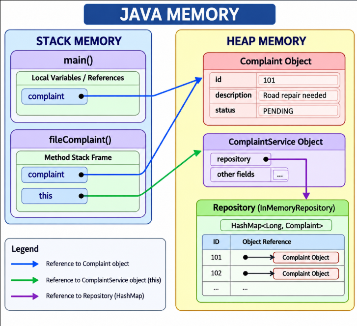

# Day 10 - Java Memory Management Review

## Project
Public Grievance Complaint Redressal Portal

## Objective
Review the existing Java application for memory pitfalls
and analyze stack and heap memory allocation.

## Files Reviewed

1. ComplaintService.java
2. Complaint.java
3. ComplaintRepository.java
4. InMemoryRepository.java

## Memory Review Findings

### 1. Multiple References to Field Workers

ComplaintService maintains both a HashMap and an ArrayList
containing references to FieldWorker objects.

This does not duplicate the actual objects.

Recommendation:
Keep both collections synchronized.

### 2. Temporary Collections

ComplaintService creates temporary ArrayLists for sorting
complaint reports.

InMemoryRepository also creates temporary lists when
findAll() is called.

These lists contain references to existing objects.

They become eligible for garbage collection when no
longer reachable.

Recommendation:
No immediate changes required.

### 3. Pending Complaint Queue

ComplaintRepository maintains an ArrayDeque containing
pending complaints.

A complaint can remain in the queue after its status
changes if the queue is not updated.

This can cause stale references and incorrect routing.

Recommendation:
Synchronize the queue when complaint statuses change.

### 4. Unbounded HashMap Growth

InMemoryRepository stores entities in a HashMap.

Memory usage increases as the number of stored entities
grows.

Recommendation:
Consider persistent storage and a data-retention policy
for production use.

### 5. Complaint Object Allocation

Complaint objects are created using the new keyword.

Objects are allocated on the heap.

Primitive fields are stored within the object, while
reference fields refer to other objects.

No obvious memory-retention issue was identified
in Complaint.java.

## Business Method Selected

ComplaintService.fileComplaint()

Parameters:
- citizenId
- category
- description
- location

Local Variables:
- complaintId
- complaint
- saved

## Stack Memory

The stack contains the execution frame for fileComplaint().

It holds local variables, parameters, and references.

The method frame is removed after execution finishes.

## Heap Memory

The heap contains:
- ComplaintService object
- Complaint object
- ComplaintRepository object
- InMemoryRepository object
- HashMap
- ArrayDeque
- Referenced String objects

The newly created complaint is stored in the repository.

The pending queue also references the same complaint object.

## Garbage Collection

After fileComplaint() finishes, its stack frame is removed.

The Complaint object remains reachable through the
repository and pending queue.

Therefore, the complaint is not eligible for garbage
collection while those references remain.

## Conclusion

The memory review did not identify a definite memory leak.

Potential concerns include stale queue references and
unbounded in-memory collection growth.

Temporary collections and multiple references to the
same object are not inherently memory leaks.

The stack/heap analysis demonstrates how Java manages
method execution and object allocation.

